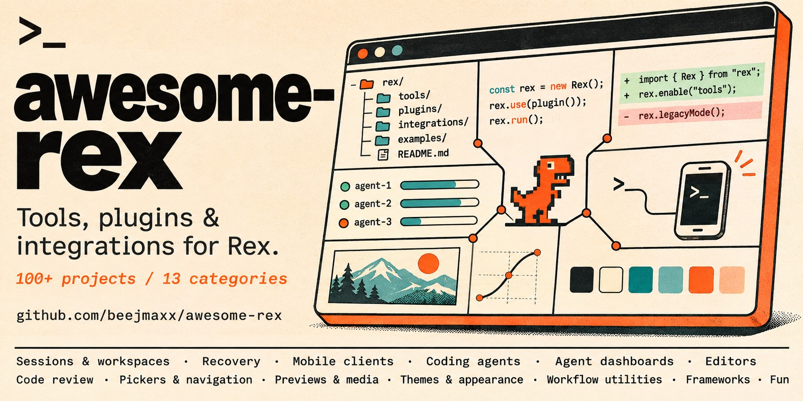

# Awesome Rex 

A curated list of public tools, plugins, and integrations for Rex, the terminal workspace by Superlogical, built on its documented Lua config, CLI, and server API. Rex is in closed beta, so most of these are early and move fast. *demo* links go to a GIF, video, or screenshot.

## Contents

- [Sessions and workspaces](#sessions-and-workspaces)
- [Recovery](#recovery)
- [Mobile clients](#mobile-clients)
- [Coding agents](#coding-agents)
- [Agent dashboards](#agent-dashboards)
- [Editors](#editors)
- [Code review](#code-review)
- [Pickers and navigation](#pickers-and-navigation)
- [Previews and media](#previews-and-media)
- [Themes and appearance](#themes-and-appearance)
- [Workflow utilities](#workflow-utilities)
- [Frameworks](#frameworks)
- [Fun](#fun)
- [Official resources](#official-resources)

## Sessions and workspaces

- [rexkit](https://github.com/snipeship/rexkit) - Session manager with a file picker and tmux-style keybindings. ([demo](https://github.com/user-attachments/assets/d1d325c4-4cff-4e40-b755-0541d977c1b7)) 
- [raycast-rex-sessions](https://github.com/esttorhe/raycast-rex-sessions) - Raycast extension for switching sessions, sesh entries, and zoxide directories. 
- [rex-sessionizer](https://github.com/haxybaxy/rex-sessionizer) - Floating fzf project picker that opens or creates a directory's session. 
- [herdr2rex](https://github.com/tornikegomareli/herdr2rex) - Imports herdr workspaces into Rex, including resumable agent conversations. 
- [rex-sessions by arnold-c](https://github.com/arnold-c/rex-sessions) - Fuzzy session and project picker with pinned sessions and remote servers. 
- [resh](https://github.com/CruelAddict/resh) - Native macOS session manager with project discovery and an agent view. 
- [rex-sessions-alfred](https://github.com/LouLouLibs/rex-sessions-alfred) - Alfred workflow for finding and switching to local and remote Rex tabs. 
- [rexp](https://github.com/itsjustaplant/rexp) - Saves and launches project workspaces defined in YAML. 
- [sex](https://github.com/rtuszik/sex) - Session picker combining Rex sessions, sesh config, and zoxide directories. 
- [rex-sessionizer by 0xViva](https://github.com/0xViva/rex-sessionizer) - Fzf project switcher that opens sessions and runs configured commands. 
- [hatch](https://github.com/gcacoutinho/rex-hatch) - Creates sessions from per-project Lua layout files, with an fzf picker. 
- [ghostmux](https://github.com/jackkeller/ghostmux) - Launches YAML-defined sessions, tabs, and pane layouts on macOS. 
- [lazyrex](https://github.com/rbobillot/lazyrex) - Terminal UI for managing sessions, windows, and panes across Rex servers. 

## Recovery

- [rexume](https://github.com/Entwining/rexume) - Restores sessions and agent conversations after the Rex server stops. 
- [rexurrect](https://github.com/cemcatik/rexurrect) - Saves and recreates sessions after a crash or reboot, like tmux-resurrect. 
- [rex-sessions](https://github.com/AlbertoBarrago/rex-sessions) - Saves and restores layouts and working directories, with macOS autosave. 
- [rex-agent-archive](https://github.com/unknowntheory/rex-agent-archive) - Archives Claude Code and Codex conversations when tabs close, to resume later. 
- [rex-agent-resume](https://github.com/YangJonghun/rex-agent-resume) - Resumes coding agents in their original panes after a server restart on macOS. 
- [rex-restore-claude](https://github.com/marfillaster/rex-restore-claude) - Puts a Claude Code resume command in each pane's prompt after a restart. 

## Mobile clients

- [RexPocket](https://github.com/leizhiyuan/rexpocket) - Android client for browsing sessions, reading output, and sending input. 
- [Rexling](https://github.com/shulhi/rexling) - Unofficial Android client for Rex terminals across servers over Tailscale. 
- [rexc](https://github.com/Nam0101/rexc) - Android client with sessions, terminals, and an inbox for blocked agents. 
- [Rhubarb](https://github.com/Joshua-Wise/rhubarb) - Unofficial Android client with live terminals and agent alerts over Tailscale. 

## Coding agents

- [rex-agent-kit](https://github.com/theJiawen/rex-agent-kit) - Tiles every tab into one grid and back, plus a key for a Claude Code tab. ([demo](https://github.com/theJiawen/rex-agent-kit/blob/main/docs/agent-wall.gif)) 
- [ah](https://github.com/david-crespo/ah) - HTML tools such as dashboards and diff viewers that talk back to your agent. ([demo](https://github.com/david-crespo/ah#readme)) 
- [Amber](https://amber.benhid.dev/) - Suggests `CLAUDE.md` changes when a Claude Code session goes idle.
- [Pi runbook](https://github.com/polo871209/dotfiles/tree/main/.pi/agent/extensions/runbook) - Turns commands from Pi agents into steps you run, paste, or copy.
- [rexgram](https://github.com/beejmaxx/rexgram) - Talk to the Claude Code and Codex agents in your panes from Telegram. 
- [rex-launch](https://github.com/nicosuave/rex-launch) - Popup that launches Claude Code or Codex with a prompt in a new Git worktree. 
- [rex-mcp-bridge](https://github.com/fatwang2/rex-mcp-bridge) - MCP server that lets agents read and run commands in visible Rex windows. 
- [rex-agent-relay](https://github.com/civitaspo/rex-agent-relay) - Relays turns and changed files between paired Claude Code and Codex agents. 
- [Rex extensions for Claude Code](https://github.com/evgeny-golubev/rex-extensions) - Adds an activity sidecar, conversation recovery, and file previews on macOS. 
- [clnkr](https://github.com/clnkr-ai/clnkr) - Coding agent CLI that reports its state to Rex's status indicators. 
- [hermes-rex](https://github.com/vanhoof/hermes-rex) - Hermes Agent plugin for Rex program status and pane context. 
- [rex-grokbot-bridge](https://github.com/smarzban/rex-grokbot-bridge) - MCP and webhook bridge that lets Grok Bot inspect and control Rex panes. 
- [tr3x](https://github.com/macnason/tr3x) - Shows T3 Code conversations as Rex tabs, with replies sent back to T3. 
- [barbasol-can](https://github.com/pthm/barbasol-can) - Moves Claude Code, Codex, and OpenCode conversations to another Rex host. 
- [rex-claude](https://www.aitmpl.com/component/skill/productivity/rex-claude) - Claude Code skill that opens and drives other Claude Code sessions in panes.

## Agent dashboards

- [rex-radar](https://github.com/hecspc/rex-radar) - Menu bar, widget, iPhone, and Apple Watch apps showing every Claude agent. ([demo](https://github.com/hecspc/rex-radar/blob/main/docs/screenshots/mac-panel.png)) 
- [rexboard](https://github.com/vanducng/rexboard) - Attention board showing which agent panes are waiting, and for how long. ([demo](https://github.com/vanducng/rexboard/blob/main/docs/assets/demo.gif)) 
- [cheap-rex-display](https://github.com/yethranayeh/cheap-rex-display) - ESP32 desk display that shows agent status and blinks when one needs you. ([demo](https://res.cloudinary.com/drwbqceye/image/upload/v1792852978/opencode-status-cycle_r6f1ad.webp)) 
- [ai-usage](https://github.com/trishtzy/ai-usage) - Tracks Claude Code, Codex, and other AI usage limits inside Rex. ([demo](https://github.com/trishtzy/ai-usage/blob/main/ai-usage-demo.gif)) 
- [rex-usage](https://github.com/AlbertoBarrago/rex-usage) - Claude Code and Codex usage dashboard with token charts and cost estimates. 
- [Shepherd](https://github.com/getshepherd/shepherd) - Desktop agent dashboard with an experimental Rex backend on macOS. 
- [Opscope mux-activity](https://github.com/stealth-factory/opscope/tree/main/widgets/src/widgets/mux-activity) - Lists Rex agents and processes by how much attention they need.
- [rexpad](https://github.com/almonk/rexpad) - Live agent todo lists rendered beside the agent. 
- [rex-micro](https://github.com/JiehoonKwak/rex-micro) - Turns a Work Louder Codex Micro into an agent status display and controller. 
- [rexq](https://github.com/tfcace/rexq) - Floating inbox for questions and decisions from Claude Code and Pi. 
- [Tea](https://github.com/ianiv/tea) - macOS menu bar monitor for Claude Code sessions that jumps to their panes. 
- [agentmeter](https://github.com/SaeedNoshadi89/agentmeter) - Shows remaining Claude Code and Codex usage limits in a popup or pane. 
- [Rex's Tail](https://github.com/travelingflwr/rex-tail) - macOS panel beside the Rex window showing agent activity and weather. 
- [rex-agents](https://github.com/irfn/rex-agents) - Agent sidebar across hosts that jumps to agents waiting for input. 

## Editors

- [rex-navigator.nvim](https://github.com/baggiponte/rex-navigator.nvim) - `Ctrl-h/j/k/l` across Neovim windows and Rex panes, like vim-tmux-navigator. ([demo](https://github.com/baggiponte/rex-navigator.nvim/blob/main/docs/assets/navigation.gif)) 
- [smart-splits-backend-rex](https://github.com/rawnly/smart-splits-backend-rex) - Rex backend for smart-splits.nvim: navigate and resize across Neovim and Rex. 
- [nvim-rex](https://github.com/theboxer/nvim-rex) - Seamless navigation between Neovim and Rex. 
- [neorex](https://github.com/alexrlocke/neorex) - macOS Neovim frontend that maps editor splits to Rex panes. 
- [colorrex.nvim](https://github.com/reklai/colorrex.nvim) - Neovim colorscheme built from Rex's terminal palette, updated live. 
- [navigator.nvim](https://github.com/omenlog/neovim-navigator) - Moves focus between Neovim splits and Rex panes with the same keys. 
- [lazyrex.nvim](https://github.com/omenlog/lazyrex) - Persistent LazyGit float that opens files in the originating Neovim. 
- [vim-rex-navigator](https://github.com/pankrashin/vim-rex-navigator) - Focus, move, resize, and close Vim windows and Rex panes with the same keys. 
- [rex-runner.nvim](https://github.com/oligot/rex-runner.nvim) - Port of vim-tmux-runner: sends lines and commands to a scratch pane. 

## Code review

- [rexdiff](https://github.com/rednafi/rexdiff) - Review what a coding agent changed without leaving Rex, like herdr-reviewr. ([demo](https://github.com/user-attachments/assets/d56af0f9-e1ff-422d-b0e7-0e5afe3320ae)) 
- [reviewr.nvim](https://github.com/paul-enz/reviewr.nvim) - Review Git diffs in Neovim and send line comments to an agent in Rex. ([demo](https://github.com/paul-enz/reviewr.nvim/blob/main/assets/demo.gif)) 
- [tuicr](https://github.com/agavra/tuicr) - Terminal diff reviewer with line comments, plus a skill to open it in Rex. 
- [rexdiff by victorvf](https://github.com/victorvf/rexdiff) - Live file tree and Git diffs in a pane, with staging and commits. 
- [rexamine](https://github.com/segersniels/rexamine) - Review local changes or a GitHub PR and send line comments to your agent. ([demo](https://github.com/segersniels/rexamine/blob/main/assets/demo.gif)) 
- [rex.nvim](https://github.com/rawnly/rex.nvim) - Annotate code in Neovim and send comments to a coding agent in Rex. ([demo](https://github.com/user-attachments/assets/47bc945d-6377-4df5-80a6-93bd219fd1b6)) 
- [rex-relay.nvim](https://github.com/crierr/rex-relay.nvim) - Sends file:line references and review comments from Neovim to agents in Rex. 

## Pickers and navigation

- [Pane Switcher for Rex](https://github.com/Kristijan/pane-switcher-for-rex) - Native macOS picker that searches panes across local and remote hosts. 
- [rex-opener](https://github.com/shaheislam/rex-opener) - Open URLs and file paths from terminal output with configurable keybindings. ([demo](https://github.com/shaheislam/rex-opener/blob/main/assets/demo.gif)) 
- [Tab Numbers for Rex](https://github.com/manishprivet/.dotfiles/tree/main/.config/rex/extensions/tab-numbers) - Numbers tab titles to match indexed keyboard shortcuts on macOS.
- [rex-worktrunk](https://github.com/haxybaxy/rex-worktrunk) - Fzf pickers for Git worktrees through worktrunk, with a session per worktree. 
- [sshpick](https://github.com/calvindotnow/sshpick) - Floating SSH host picker that opens connections in named tabs. 
- [Rex Worktrees](https://github.com/samuelho-dev/rex-worktrees) - Picker for Git worktrees and Jujutsu workspaces in Rex sessions. 
- [Rex copy-mode](https://github.com/CJNE/rex-copy-mode) - Opens scrollback in a Neovim overlay for keyboard search and copying. 
- [rex-open](https://github.com/HaydenMeloche/rex-open) - Picks files, links, commands, and SQL from pane output to open or copy. 
- [rex-fzf-url](https://github.com/devert/rex-fzf-url) - Floating fzf picker for opening or copying URLs from pane scrollback. 
- [rex-fingers](https://github.com/xeind/rex-fingers) - Letter hints to copy paths, URLs, and hashes from a pane, like tmux-fingers. 

## Previews and media

- [Rex Markdown for Pi](https://github.com/jal-co/jalco-dotfiles/tree/main/tools/rex-markdown) - Previews Markdown links from Pi beside the originating pane on macOS.
- [krd](https://github.com/zzjcool/krd) - Shows and controls a macOS desktop in a Rex pane over SSH with Kitty graphics. 
- [tkmp](https://github.com/tfcace/tkmp) - Live Markdown and Mermaid previews in a pane through Kitty graphics. 
- [md-viewer](https://github.com/good-banana/rexworks/tree/main/md-viewer) - Renders Markdown in a Rex pane with links, search, and live updates.
- [rexshow](https://github.com/wcwung/rexshow) - Shows screenshots and screen recordings beside your coding agents. 
- [rex-canvas](https://github.com/AlbertoBarrago/rex-canvas) - Watches a PNG and shows updates in a pane beside the agent. 
- [rex-typst](https://github.com/CiaranMcDonnell/rex-typst) - Live Typst preview in a Rex pane, including unsaved Neovim buffers. 
- [scrcpyt](https://github.com/leset0ng/scrcpyt) - Mirrors and controls Android devices in Rex through scrcpy and Kitty graphics. 
- [rex-sim](https://github.com/wobsoriano/rex-sim) - Shows and controls iOS simulators and Android emulators in panes on macOS. 

## Themes and appearance

- [rex-nobeta-icon](https://github.com/Stanzilla/rex-nobeta-icon) - Replaces the beta app icon with the plain one; re-run after each update. 
- [rex-themes](https://github.com/AlbertoBarrago/rex-themes) - Theme library and CLI for previewing and importing Rex themes. 
- [rex-theme-importer](https://github.com/alexrlocke/rex-theme-importer) - Fzf picker for previewing Ghostty themes and importing them into Rex. 
- [rexeme](https://github.com/DeepanshuMishraa/rexeme) - Applies Rex's theme to 52 editors, terminals, and CLI tools on macOS. 

## Workflow utilities

- [rex-image-paste](https://github.com/pablasso/rex-image-paste) - Paste images into remote hosts with `Cmd+Shift+V`. 
- [logi-rex](https://github.com/aruniverse/logi-rex) - Maps Logitech controls to Rex tabs, panes, and sessions. 
- [RAFT](https://github.com/theboxer/raft) - Nine floating terminal slots per session, tab, or pane. 
- [Courier](https://github.com/abhi-reducto/courier) - macOS menu bar app that sends files over SSH and pastes their remote paths. 
- [Rex Floaters](https://github.com/enkelm/rex-floaters) - Reusable floating terminals for tools such as LazyGit and btop. 
- [rex8s](https://github.com/vitalbh/rex8s) - Kubernetes toolkit with cluster panes, log splits, and rollout status. 
- [heypad](https://github.com/travelingflwr/heypad) - HEY email client rendered in Rex panes. 
- [RexDeck](https://github.com/Mathews-Tom/RexDeck) - Opt-in integrations for terminal tools and API views in native panes. 
- [Herdrex](https://github.com/elonnzhang/Herdrex) - Serves a Herdr server as a Rex host, so Rex.app can drive Herdr's panes. ([demo](https://github.com/elonnzhang/Herdrex/blob/main/imgs/herdrex-in-rex.png)) 

## Frameworks

- [LazyRex](https://github.com/lazy-rex/LazyRex) - Plugin hub with versioned plugins, dependencies, and cross-server messaging. 
- [Amber](https://github.com/rawnly/amber) - Lua plugin manager with versions and a lockfile, formerly Rex Plugin Manager. 
- [rexuikit](https://github.com/dphaener/rexuikit) - Go toolkit for building Rex UIs: floating layers, splits, forms, and dialogs. 

## Fun

- [rex-orbit](https://github.com/benhid/rex-orbit) - Your Claude Code agents as pixel bots orbiting a dinosaur. ([demo](https://github.com/benhid/rex-orbit/blob/main/assets/demo-light.png)) 

## Official resources

- [Rex](https://www.superlogical.com/rex) - Product page.
- [Documentation](https://www.superlogical.com/rex/docs) - Lua config, keybindings, CLI, and the server API.

## Contributing

Additions are welcome. See [CONTRIBUTING.md](CONTRIBUTING.md).
