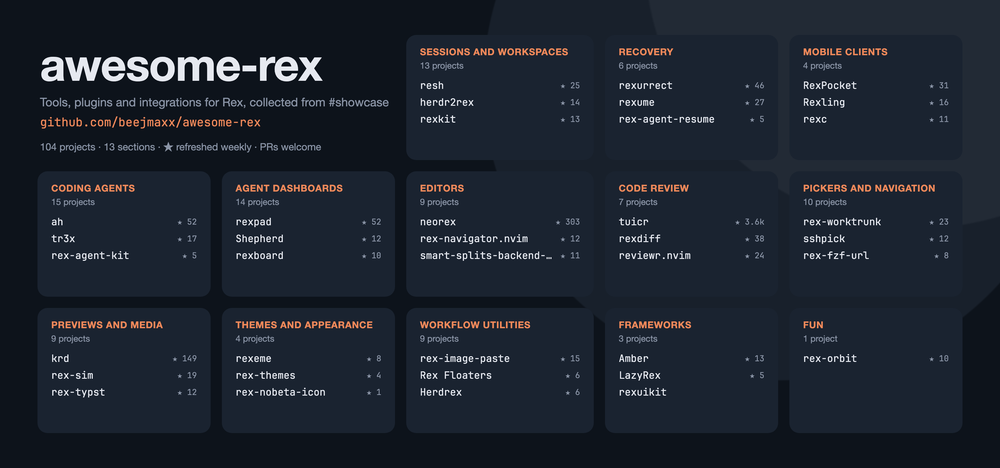

# Awesome Rex 

A curated list of tools, plugins, and integrations for Rex, the terminal workspace by Superlogical. Rex is in closed beta, so most of these are early and move fast.

Entries marked *demo* link to a GIF, video, or screenshot from the project.

Everything here is a public project built on Rex's documented Lua config, CLI, and server API. This list doesn't link to Rex downloads or to beta-only channels.

## Contents

- [Sessions and recovery](#sessions-and-recovery)
- [Coding agents](#coding-agents)
- [Agent dashboards](#agent-dashboards)
- [Editors](#editors)
- [Code review](#code-review)
- [Workflow utilities](#workflow-utilities)
- [Frameworks](#frameworks)
- [Fun](#fun)
- [Official resources](#official-resources)

## Sessions and recovery

- [rexume](https://github.com/Entwining/rexume) - Restores sessions, tabs, splits, working directories, and Claude Code, Codex, and Pi conversations after the Rex server stops. Re-prompts only agents whose turn was cut off.
- [rexurrect](https://github.com/cemcatik/rexurrect) - Saves sessions and recreates them after a crash, update, or reboot, like tmux-resurrect. Keeps scrollback.
- [rexkit](https://github.com/snipeship/rexkit) - Session manager that can create, rename, and close sessions, plus a file picker, tmux/zellij-style keybindings, and scrollback in Neovim. ([demo](https://github.com/user-attachments/assets/d1d325c4-4cff-4e40-b755-0541d977c1b7))
- [raycast-rex-sessions](https://github.com/esttorhe/raycast-rex-sessions) - Raycast extension for switching Rex sessions, sesh entries, and zoxide directories.
- [rex-sessionizer](https://github.com/haxybaxy/rex-sessionizer) - Floating fzf project picker that switches to a directory's Rex session, creating it if needed. Supports nested project directories.
- [RexPocket](https://github.com/leizhiyuan/rexpocket) - Android client for browsing Rex sessions, tabs, and panes, reading terminal output, and sending input through the server API. Build the APK from source.
- [rex-sessions](https://github.com/AlbertoBarrago/rex-sessions) - Saves and restores session layouts, pane labels, and working directories, with optional autosave on macOS. Restores shells without scrollback or running programs.
- [herdr2rex](https://github.com/tornikegomareli/herdr2rex) - Imports herdr workspaces into Rex with tabs, splits, working directories, and resumable agent conversations. Supports incremental imports and exporting Rex sessions back to herdr.
- [rex-sessions by arnold-c](https://github.com/arnold-c/rex-sessions) - Fuzzy session and project picker with pinned sessions, per-host shortcuts, previews, and remote server switching.
- [resh](https://github.com/CruelAddict/resh) - Native macOS session manager with project discovery, pinned sessions, and an agent view across local and remote hosts.
- [rex-sessions-alfred](https://github.com/LouLouLibs/rex-sessions-alfred) - Alfred workflow for finding local and remote Rex tabs, previewing their output with Quick Look, and switching to them.
- [rex-agent-archive](https://github.com/unknowntheory/rex-agent-archive) - Archives Claude Code and Codex conversations when tabs close, with a palette picker to resume them in new tabs.
- [Rexling](https://github.com/shulhi/rexling) - Unofficial Android client for viewing and controlling Rex terminals across servers over Tailscale. Includes source build instructions.
- [rexp](https://github.com/itsjustaplant/rexp) - Saves and launches named project workspaces with YAML-defined tabs, pane layouts, commands, and environment variables. Supports capturing an existing workspace.
- [sex](https://github.com/rtuszik/sex) - Session manager combining running Rex sessions, sesh configuration, and zoxide directories, with floating session and activity pickers.
- [rex-sessionizer by 0xViva](https://github.com/0xViva/rex-sessionizer) - Fzf project switcher that creates or selects Rex sessions and runs configured commands in reusable panes.
- [Pane Switcher for Rex](https://github.com/Kristijan/pane-switcher-for-rex) - Native macOS picker that searches pane titles, commands, sessions, tabs, and directories across local and remote hosts.
- [hatch](https://github.com/gcacoutinho/rex-hatch) - Creates sessions from per-project Lua layout files, with an fzf project picker and a macOS folder-dialog fallback.
- [rex-agent-resume](https://github.com/YangJonghun/rex-agent-resume) - Resumes supported coding agents in their original panes after a local Rex server restart on macOS. Also supports registered resume commands for other tools.
- [rexc](https://github.com/Nam0101/rexc) - Android client with Rex sessions, tabs, terminals, and an inbox for blocked agents, including replies from notifications. Includes APK build instructions.
- [rex-restore-claude](https://github.com/marfillaster/rex-restore-claude) - Restores a Claude Code resume command to each pane's zsh prompt after a server restart, ready for Enter to resume the conversation.
- [Rhubarb](https://github.com/Joshua-Wise/rhubarb) - Unofficial Android client for managing Rex sessions, using live terminals, and replying to agent alerts over Tailscale. Offers public APK downloads.
- [ghostmux](https://github.com/jackkeller/ghostmux) - Launches YAML-defined sessions, tabs, and pane layouts through the Rex CLI on macOS, with automatic terminal detection.

## Coding agents

- [rex-agent-kit](https://github.com/theJiawen/rex-agent-kit) - Agent Wall tiles every tab into one grid and back again without restarting anything (it uses `session.move_block`). Also adds a key that opens a tab with Claude Code running. ([demo](https://github.com/theJiawen/rex-agent-kit/blob/main/docs/agent-wall.gif))
- [ah](https://github.com/david-crespo/ah) - Local server and CLI for HTML tools that talk back to the agent running in a Rex tab: dashboards, task trackers, Markdown preview, diff and HTML viewers, all with highlight-and-comment. ([demo](https://github.com/david-crespo/ah#readme))
- [Amber](https://amber.benhid.dev/) - When a Claude Code session goes idle, suggests changes to your `CLAUDE.md` for you to accept or reject.
- [Pi runbook](https://github.com/polo871209/dotfiles/tree/main/.pi/agent/extensions/runbook) - Turns commands from Pi agents into interactive steps that run inline, paste into a Rex pane, or copy to the clipboard.
- [rexgram](https://github.com/beejmaxx/rexgram) - Talk to the Claude Code and Codex agents in your Rex panes from Telegram. Messages go to the focused pane, and you can switch panes from your phone. Replies come back, and permission prompts arrive as buttons. It stays quiet while you're at your desk.
- [rex-launch](https://github.com/nicosuave/rex-launch) - Composer popup that launches Claude Code or Codex with a prompt in a new Git worktree through worktrunk. Supports local and remote Rex projects.
- [rex-mcp-bridge](https://github.com/fatwang2/rex-mcp-bridge) - MCP server that lets agents read terminal output and run commands in visible Rex windows across hosts, with persistent shells and per-client access controls.
- [rex-agent-relay](https://github.com/civitaspo/rex-agent-relay) - Hands new conversation turns, changed file paths, and a note between paired Claude Code and Codex agents working in the same directory.
- [Rex extensions for Claude Code](https://github.com/evgeny-golubev/rex-extensions) - Adds a changes and activity sidecar, animated agent crabs, conversation recovery, and floating file previews on macOS.
- [clnkr](https://github.com/clnkr-ai/clnkr) - Coding agent CLI that reports working, blocked, done, and error states through OSC 7501 for Rex's program status indicators.
- [hermes-rex](https://github.com/vanhoof/hermes-rex) - Hermes Agent plugin that reports program status, supplies Rex pane context, and installs a Rex CLI skill.
- [rex-grokbot-bridge](https://github.com/smarzban/rex-grokbot-bridge) - MCP and webhook bridge for Grok Bot to inspect and control shared Rex panes over Tailscale and receive agent status updates.
- [tr3x](https://github.com/macnason/tr3x) - Displays T3 Code conversations as Rex tabs, with replies, approvals, and questions sent back to T3.
- [barbasol-can](https://github.com/pthm/barbasol-can) - Transfers Claude Code, Codex, and OpenCode conversations to another Rex host and resumes them in a selected directory and session.

## Agent dashboards

- [rex-radar](https://github.com/hecspc/rex-radar) - Menu bar app, widget, and iPhone, iPad, and Apple Watch apps showing every Claude agent across your Rex servers. Answer questions and jump to panes. Build it yourself in Xcode. ([demo](https://github.com/hecspc/rex-radar/blob/main/docs/screenshots/mac-panel.png))
- [rexboard](https://github.com/vanducng/rexboard) - Attention board for agent panes on every host: which one is waiting, for how long, and a key to jump there. ([demo](https://github.com/vanducng/rexboard/blob/main/docs/assets/demo.gif))
- [cheap-rex-display](https://github.com/yethranayeh/cheap-rex-display) - ESP32 "Cheap Yellow Display" that shows agent status on your desk and blinks when one needs you. ([demo](https://res.cloudinary.com/drwbqceye/image/upload/v1792852978/opencode-status-cycle_r6f1ad.webp))
- [ai-usage](https://github.com/trishtzy/ai-usage) - Tracks Claude Code, Codex, and other AI usage limits inside Rex. ([demo](https://github.com/trishtzy/ai-usage/blob/main/ai-usage-demo.gif))
- [rex-usage](https://github.com/AlbertoBarrago/rex-usage) - Claude Code and Codex usage dashboard with project and model breakdowns, token charts, and estimated API costs in a Rex pane.
- [Shepherd](https://github.com/getshepherd/shepherd) - Desktop terminal and agent dashboard with an experimental Rex backend on macOS for viewing existing sessions and agent status.
- [Opscope mux-activity](https://github.com/stealth-factory/opscope/tree/main/widgets/src/widgets/mux-activity) - Lists Rex agents and processes by attention needed, using program status reports, with shortcuts to focus, zoom, and inspect panes.
- [rexpad](https://github.com/almonk/rexpad) - Live agent todo lists rendered beside the agent with task groups, progress indicators, and colors from the Rex theme.
- [rex-micro](https://github.com/JiehoonKwak/rex-micro) - Turns a Work Louder Codex Micro into an agent status display and controller for Rex, with pane switching and configurable keys, dial, and stick.
- [rexq](https://github.com/tfcace/rexq) - Collects questions and decisions from Claude Code and Pi into a floating inbox, with replies, snoozing, and links to the originating panes.
- [Tea](https://github.com/ianiv/tea) - macOS menu bar monitor for Claude Code sessions that focuses their Rex panes or opens background agents in new tabs. Build from source.
- [agentmeter](https://github.com/SaeedNoshadi89/agentmeter) - Shows remaining Claude Code and Codex usage limits in a Rex popup or docked pane, with support for multiple accounts.
- [Rex's Tail](https://github.com/travelingflwr/rex-tail) - macOS widget panel that follows the Rex window and displays agent activity and weather. Build from source.
- [rex-agents](https://github.com/irfn/rex-agents) - Agent sidebar across local sessions and remote hosts, with shortcuts to jump to agents waiting for input.

## Editors

- [rex-navigator.nvim](https://github.com/baggiponte/rex-navigator.nvim) - `Ctrl-h/j/k/l` across Neovim windows and Rex panes, like vim-tmux-navigator. ([demo](https://github.com/baggiponte/rex-navigator.nvim/blob/main/docs/assets/navigation.gif))
- [smart-splits-backend-rex](https://github.com/rawnly/smart-splits-backend-rex) - Rex backend for smart-splits.nvim: navigate and resize across Neovim and Rex.
- [nvim-rex](https://github.com/theboxer/nvim-rex) - Seamless navigation between Neovim and Rex.
- [neorex](https://github.com/alexrlocke/neorex) - Neovim frontend for macOS that maps editor splits to Rex panes, sharing buffers, registers, undo, and language servers through one Neovim process.
- [lazyrex.nvim](https://github.com/omenlog/lazyrex) - Opens a persistent LazyGit float from Neovim in Rex, returning selected files to the originating editor while preserving LazyGit's state.
- [colorrex.nvim](https://github.com/reklai/colorrex.nvim) - Builds a Neovim colorscheme from Rex's terminal palette and updates it as the terminal theme changes.

## Code review

- [rexdiff](https://github.com/rednafi/rexdiff) - Review what a coding agent changed without leaving Rex, in the style of herdr-reviewr. ([demo](https://github.com/user-attachments/assets/d56af0f9-e1ff-422d-b0e7-0e5afe3320ae))
- [reviewr.nvim](https://github.com/paul-enz/reviewr.nvim) - Review Git diffs in Neovim and send line comments to an agent running in Rex, tmux, or WezTerm. ([demo](https://github.com/paul-enz/reviewr.nvim/blob/main/assets/demo.gif))
- [tuicr](https://github.com/agavra/tuicr) - Terminal diff reviewer with line comments and review exports, including an agent skill that opens reviews in a Rex split.
- [rexamine](https://github.com/segersniels/rexamine) - Reviews local changes and GitHub pull requests beside an agent, sending selected lines and comments into its prompt or posting comments to GitHub.
- [rexdiff by victorvf](https://github.com/victorvf/rexdiff) - Live file tree and colored Git diffs in a Rex pane, with review tracking, staging, commits, and branch operations.
- [rexamine](https://github.com/segersniels/rexamine) - Review local changes or a GitHub pull request in a pane beside your coding agent, and send comments on selected lines into the agent's prompt. ([demo](https://github.com/segersniels/rexamine/blob/main/assets/demo.gif))
- [rex.nvim](https://github.com/rawnly/rex.nvim) - Annotate code in Neovim and send comments or file references to a coding agent in a Rex session. ([demo](https://github.com/user-attachments/assets/47bc945d-6377-4df5-80a6-93bd219fd1b6))

## Workflow utilities

- [rex-opener](https://github.com/shaheislam/rex-opener) - Open URLs and file paths from terminal output with configurable keybindings. ([demo](https://github.com/shaheislam/rex-opener/blob/main/assets/demo.gif))
- [rex-image-paste](https://github.com/pablasso/rex-image-paste) - Paste images into remote hosts by copying them to a temporary file there (`Cmd+Shift+V`).
- [rex-nobeta-icon](https://github.com/Stanzilla/rex-nobeta-icon) - Replaces the beta app icon with the plain one. Re-run it after each update.
- [Tab Numbers for Rex](https://github.com/manishprivet/.dotfiles/tree/main/.config/rex/extensions/tab-numbers) - Numbers tab titles to match indexed keyboard shortcuts on macOS.
- [rex-worktrunk](https://github.com/haxybaxy/rex-worktrunk) - Floating fzf pickers to switch, create, and remove Git worktrees through worktrunk, with a Rex session per worktree.
- [Rex Markdown for Pi](https://github.com/jal-co/jalco-dotfiles/tree/main/tools/rex-markdown) - Opens local Markdown links from Pi in a terminal-browser preview beside the originating Rex pane on macOS.
- [logi-rex](https://github.com/aruniverse/logi-rex) - Maps Logitech controls to Rex tabs, panes, and sessions through OpenLogi configuration exports and Rex keybindings. Includes an experimental Logi Options+ bridge.
- [RAFT](https://github.com/theboxer/raft) - Nine floating terminal slots per session, tab, or pane, with a searchable manager and output preview. Hiding terminals keeps their processes running.
- [sshpick](https://github.com/calvindotnow/sshpick) - Floating SSH host picker that opens connections in named Rex tabs, grouped into sessions by SSH config tags. Supports adding and deleting hosts.
- [Courier](https://github.com/abhi-reducto/courier) - macOS menu bar app that transfers files over SSH to Tailscale machines and pastes their remote paths into coding agent panes in Rex.
- [rex-themes](https://github.com/AlbertoBarrago/rex-themes) - Theme library and Python CLI for previewing colors in a Rex pane, importing persistent app themes, and adding schemes from iTerm2-Color-Schemes.
- [krd](https://github.com/zzjcool/krd) - Displays and controls a macOS desktop inside a Rex terminal pane over SSH using Kitty graphics, with mouse and keyboard input.
- [tkmp](https://github.com/tfcace/tkmp) - Live Markdown previewer with Mermaid diagrams rendered through Kitty graphics and automatic updates on save. Includes a Rex keybinding for opening previews beside the focused pane.
- [Rex Worktrees](https://github.com/samuelho-dev/rex-worktrees) - Picker for creating and opening Git worktrees and Jujutsu workspaces in Rex sessions across machines.
- [md-viewer](https://github.com/good-banana/rexworks/tree/main/md-viewer) - Renders Markdown in a Rex pane with clickable links, text selection, search, and live updates. Opens previews from Markdown paths clicked in terminal output.
- [Rex copy-mode](https://github.com/CJNE/rex-copy-mode) - Opens styled scrollback in a Neovim overlay for keyboard search, selection, and clipboard copying.
- [rex-theme-importer](https://github.com/alexrlocke/rex-theme-importer) - Floating fzf picker for previewing Ghostty themes and importing the selected theme into Rex.
- [Rex Floaters](https://github.com/enkelm/rex-floaters) - Reusable floating terminals for tools such as LazyGit and btop, with a tab picker and keyboard hints for copying pane text.
- [rexshow](https://github.com/wcwung/rexshow) - Displays screenshots and screen recordings beside coding agents, with folder watching, zoom, and playback controls usable from Rex on iOS.
- [rex8s](https://github.com/vitalbh/rex8s) - Kubernetes toolkit with isolated cluster panes, log splits, multi-cluster views, and rollout progress in Rex's program status indicators.
- [rex-canvas](https://github.com/AlbertoBarrago/rex-canvas) - Watches a PNG and displays updates in a pane beside the agent, with pan and zoom controls and a skill for Markasso diagram exports.
- [rexeme](https://github.com/DeepanshuMishraa/rexeme) - Synchronizes Rex's theme and light or dark appearance to supported editors, terminals, and other applications on macOS.
- [rex-typst](https://github.com/CiaranMcDonnell/rex-typst) - Live Typst document preview in a Rex pane, with source navigation and support for unsaved Neovim buffers.
- [scrcpyt](https://github.com/leset0ng/scrcpyt) - Mirrors and controls Android devices in Rex through scrcpy and Kitty graphics, with mouse, keyboard, and clipboard support.
- [heypad](https://github.com/travelingflwr/heypad) - HEY email client rendered in Rex panes, with floating mail views, replies, and colors from the Rex theme.
- [rex-open](https://github.com/HaydenMeloche/rex-open) - Picks files, folders, links, commands, and SQL from pane output. Opens paths beside the source pane, prepares commands without running them, and copies SQL.
- [rex-fzf-url](https://github.com/devert/rex-fzf-url) - Finds URLs in pane scrollback and presents a floating fzf picker to open or copy them.
- [rex-sim](https://github.com/wobsoriano/rex-sim) - Displays and controls iOS simulators and Android emulators inside Rex panes on macOS.
- [RexDeck](https://github.com/Mathews-Tom/RexDeck) - Opt-in integrations for terminal tools and API views in native Rex panes, returning focus to the originating terminal when closed.

## Frameworks

- [LazyRex](https://github.com/lazy-rex/LazyRex) - Plugin hub for Rex with versioned plugins, dependencies, per-plugin databases, cross-server messaging, a TUI renderer, and plugin palette and CLI commands.
- [Amber](https://github.com/rawnly/amber) - Installs and loads GitHub Lua plugins for Rex, with version selection and a lockfile. Previously called Rex Plugin Manager.
- [rexuikit](https://github.com/dphaener/rexuikit) - Go toolkit for connecting to Rex, managing floating layers and splits, and building terminal forms, lists, and dialogs.

## Fun

- [rex-orbit](https://github.com/benhid/rex-orbit) - Your Claude Code agents as pixel bots orbiting a dinosaur, drawn with Kitty graphics. ([demo](https://github.com/benhid/rex-orbit/blob/main/assets/demo-light.png))

## Official resources

- [Rex](https://www.superlogical.com/rex) - Product page.
- [Documentation](https://www.superlogical.com/rex/docs) - Lua config, keybindings, CLI, and the server API.

## Contributing

Additions are welcome. See [CONTRIBUTING.md](CONTRIBUTING.md).
