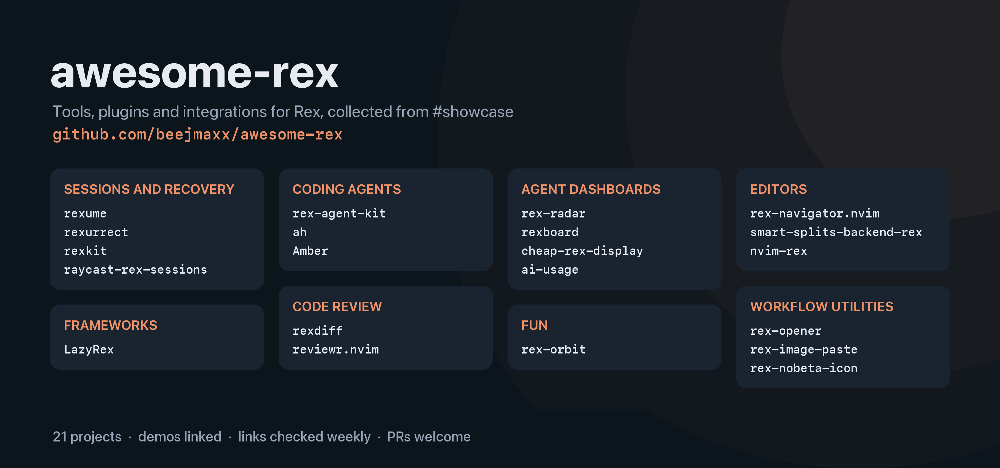

# Awesome Rex 

A curated list of tools, plugins, and integrations for Rex, the terminal workspace by Superlogical. Rex is in closed beta, so most of these are early and move fast.

Entries marked *demo* link to a GIF, video, or screenshot from the project.

Everything here is a public project built on Rex's documented Lua config, CLI, and server API. This list doesn't link to Rex downloads or to beta-only channels.

## Contents

- [Sessions and recovery](#sessions-and-recovery)
- [Coding agents](#coding-agents)
- [Agent dashboards](#agent-dashboards)
- [Editors](#editors)
- [Code review](#code-review)
- [Workflow utilities](#workflow-utilities)
- [Frameworks](#frameworks)
- [Fun](#fun)
- [Official resources](#official-resources)

## Sessions and recovery

- [rexume](https://github.com/Entwining/rexume) - Restores sessions, tabs, splits, working directories, and Claude Code, Codex, and Pi conversations after the Rex server stops. Re-prompts only agents whose turn was cut off.
- [rexurrect](https://github.com/cemcatik/rexurrect) - Saves sessions and recreates them after a crash, update, or reboot, like tmux-resurrect. Keeps scrollback.
- [rexkit](https://github.com/snipeship/rexkit) - Session manager that can create, rename, and close sessions, plus a file picker, tmux/zellij-style keybindings, and scrollback in Neovim. ([demo](https://github.com/user-attachments/assets/d1d325c4-4cff-4e40-b755-0541d977c1b7))
- [raycast-rex-sessions](https://github.com/esttorhe/raycast-rex-sessions) - Raycast extension for switching Rex sessions, sesh entries, and zoxide directories.
- [rex-sessionizer](https://github.com/haxybaxy/rex-sessionizer) - Floating fzf project picker that switches to a directory's Rex session, creating it if needed. Supports nested project directories.

## Coding agents

- [rex-agent-kit](https://github.com/theJiawen/rex-agent-kit) - Agent Wall tiles every tab into one grid and back again without restarting anything (it uses `session.move_block`). Also adds a key that opens a tab with Claude Code running. ([demo](https://github.com/theJiawen/rex-agent-kit/blob/main/docs/agent-wall.gif))
- [ah](https://github.com/david-crespo/ah) - Local server and CLI for HTML tools that talk back to the agent running in a Rex tab: dashboards, task trackers, Markdown preview, diff and HTML viewers, all with highlight-and-comment. ([demo](https://github.com/david-crespo/ah#readme))
- [Amber](https://amber.benhid.dev/) - When a Claude Code session goes idle, suggests changes to your `CLAUDE.md` for you to accept or reject.
- [Pi runbook](https://github.com/polo871209/dotfiles/tree/main/.pi/agent/extensions/runbook) - Turns commands from Pi agents into interactive steps that run inline, paste into a Rex pane, or copy to the clipboard.
- [rexgram](https://github.com/beejmaxx/rexgram) - Talk to the Claude Code and Codex agents in your Rex panes from Telegram. Messages go to the focused pane, and you can switch panes from your phone. Replies come back, and permission prompts arrive as buttons. It stays quiet while you're at your desk.
- [rex-launch](https://github.com/nicosuave/rex-launch) - Composer popup that launches Claude Code or Codex with a prompt in a new Git worktree through worktrunk. Supports local and remote Rex projects.

## Agent dashboards

- [rex-radar](https://github.com/hecspc/rex-radar) - Menu bar app, widget, and iPhone, iPad, and Apple Watch apps showing every Claude agent across your Rex servers. Answer questions and jump to panes. Build it yourself in Xcode. ([demo](https://github.com/hecspc/rex-radar/blob/main/docs/screenshots/mac-panel.png))
- [rexboard](https://github.com/vanducng/rexboard) - Attention board for agent panes on every host: which one is waiting, for how long, and a key to jump there. ([demo](https://github.com/vanducng/rexboard/blob/main/docs/assets/demo.gif))
- [cheap-rex-display](https://github.com/yethranayeh/cheap-rex-display) - ESP32 "Cheap Yellow Display" that shows agent status on your desk and blinks when one needs you. ([demo](https://res.cloudinary.com/drwbqceye/image/upload/v1792852978/opencode-status-cycle_r6f1ad.webp))
- [ai-usage](https://github.com/trishtzy/ai-usage) - Tracks Claude Code, Codex, and other AI usage limits inside Rex. ([demo](https://github.com/trishtzy/ai-usage/blob/main/ai-usage-demo.gif))

## Editors

- [rex-navigator.nvim](https://github.com/baggiponte/rex-navigator.nvim) - `Ctrl-h/j/k/l` across Neovim windows and Rex panes, like vim-tmux-navigator. ([demo](https://github.com/baggiponte/rex-navigator.nvim/blob/main/docs/assets/navigation.gif))
- [smart-splits-backend-rex](https://github.com/rawnly/smart-splits-backend-rex) - Rex backend for smart-splits.nvim: navigate and resize across Neovim and Rex.
- [nvim-rex](https://github.com/theboxer/nvim-rex) - Seamless navigation between Neovim and Rex.
- [neorex](https://github.com/alexrlocke/neorex) - Neovim frontend for macOS that maps editor splits to Rex panes, sharing buffers, registers, undo, and language servers through one Neovim process.

## Code review

- [rexdiff](https://github.com/rednafi/rexdiff) - Review what a coding agent changed without leaving Rex, in the style of herdr-reviewr. ([demo](https://github.com/user-attachments/assets/d56af0f9-e1ff-422d-b0e7-0e5afe3320ae))
- [reviewr.nvim](https://github.com/paul-enz/reviewr.nvim) - Review Git diffs in Neovim and send line comments to an agent running in Rex, tmux, or WezTerm. ([demo](https://github.com/paul-enz/reviewr.nvim/blob/main/assets/demo.gif))

## Workflow utilities

- [rex-opener](https://github.com/shaheislam/rex-opener) - Open URLs and file paths from terminal output with configurable keybindings. ([demo](https://github.com/shaheislam/rex-opener/blob/main/assets/demo.gif))
- [rex-image-paste](https://github.com/pablasso/rex-image-paste) - Paste images into remote hosts by copying them to a temporary file there (`Cmd+Shift+V`).
- [rex-nobeta-icon](https://github.com/Stanzilla/rex-nobeta-icon) - Replaces the beta app icon with the plain one. Re-run it after each update.
- [Tab Numbers for Rex](https://github.com/manishprivet/.dotfiles/tree/main/.config/rex/extensions/tab-numbers) - Numbers tab titles to match indexed keyboard shortcuts on macOS.
- [rex-worktrunk](https://github.com/haxybaxy/rex-worktrunk) - Floating fzf pickers to switch, create, and remove Git worktrees through worktrunk, with a Rex session per worktree.
- [Rex Markdown for Pi](https://github.com/jal-co/jalco-dotfiles/tree/main/tools/rex-markdown) - Opens local Markdown links from Pi in a terminal-browser preview beside the originating Rex pane on macOS.
- [logi-rex](https://github.com/aruniverse/logi-rex) - Maps Logitech controls to Rex tabs, panes, and sessions through OpenLogi configuration exports and Rex keybindings. Includes an experimental Logi Options+ bridge.
- [RAFT](https://github.com/theboxer/raft) - Nine floating terminal slots per session, tab, or pane, with a searchable manager and output preview. Hiding terminals keeps their processes running.

## Frameworks

- [LazyRex](https://github.com/lazy-rex/LazyRex) - Plugin hub for Rex with versioned plugins, dependencies, per-plugin databases, cross-server messaging, a TUI renderer, and plugin palette and CLI commands.
- [Rex Plugin Manager](https://github.com/rawnly/rex-package-manager) - Installs and loads GitHub Lua plugins for Rex, with version selection and a lockfile.

## Fun

- [rex-orbit](https://github.com/benhid/rex-orbit) - Your Claude Code agents as pixel bots orbiting a dinosaur, drawn with Kitty graphics. ([demo](https://github.com/benhid/rex-orbit/blob/main/assets/demo-light.png))

## Official resources

- [Rex](https://www.superlogical.com/rex) - Product page.
- [Documentation](https://www.superlogical.com/rex/docs) - Lua config, keybindings, CLI, and the server API.

## Contributing

Additions are welcome. See [CONTRIBUTING.md](CONTRIBUTING.md).
